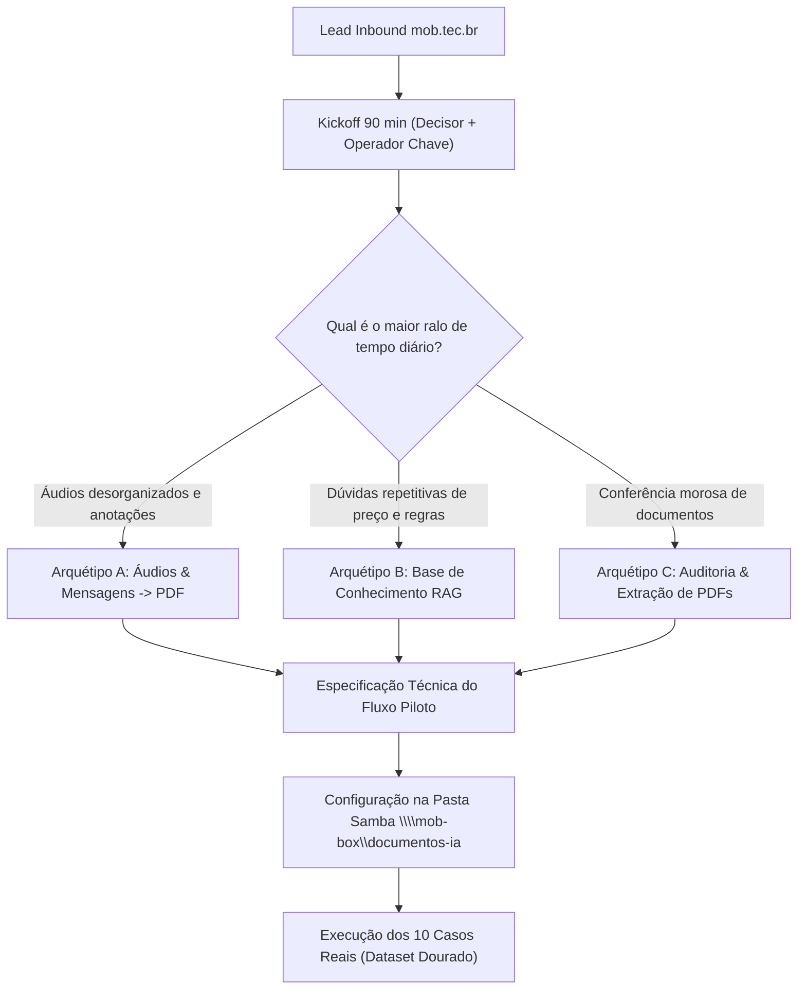

# MOB — Protocolo de Ativação do Cliente Zero Inbound (Field Implementation Guide)

**Documento:** `missions/001-strategic-foundation/10-pilot-implementation-protocol.md`  
**Missão:** 001 — Strategic Foundation  
**Onda:** Onda 4 — Operações, Piloto Fix e Pós-Venda (Execução de Campo)  
**Especialista Responsável:** `10 Pilot Implementation Engineer`  
**Governança & Coordenação:** `00 — Chief Transformation Officer (CTO)`  
**Status:** Consolidado (Onda 4)  
**Data de Referência:** 14 de Novembro de 2026  

---

## 1. Contexto, Filosofia FDE e o Perfil do Cliente Zero Inbound

### 1.1. O Papel do Forward-Deployed Engineer ("Pedreiro da IA")
Na MOB, a implantação de tecnologia não é terceirizada e não se resume a entregar uma caixa na recepção do cliente. O **Pilot Implementation Engineer** opera como um **Forward-Deployed Engineer (FDE)**:
- Atua diretamente no chão de fábrica e no balcão da empresa cliente.
- Mergulha no fluxo real de trabalho (onde o tempo da equipe vaza) e constrói a ponte imediata entre os documentos brutos da empresa e os assistentes do **MOB CORE**.
- Elimina qualquer atrito técnico: o cliente não precisa aprender engenharia de prompt, não configura banco de dados e não lida com interfaces complexas.

```
+----------------------------------------------------------------------------------------------------+
|                               ESTEIRA DE ATIVAÇÃO DO CLIENTE ZERO                                  |
+--------------------------+-------------------------------------+-----------------------------------+
| Etapa                    | Marco Temporal                      | Entrega Tangível                  |
+--------------------------+-------------------------------------+-----------------------------------+
| 1. Kickoff com Decisor   | Dia 0 (90 minutos)                  | 1º Fluxo Mapeado + 10 Casos Reais |
| 2. Instalação & Ingestão | Dia 2 a Dia 3                       | MOB Box no rack + Samba mapeado   |
| 3. Calibração do Dataset | Dia 4 a Dia 7                       | 10 Casos Dourados rodando 100%    |
| 4. Operação em Paralelo  | Dia 8 a Dia 14                      | Operador Chave usando no dia a dia|
| 5. Expansão de Rotina    | Dia 15 a Dia 21                     | Equipe do setor operando          |
| 6. Homologação & Go-Live | Dia 22 a Dia 30                     | Aceite assinado + Retainer ativo  |
+--------------------------+-------------------------------------+-----------------------------------+
```

### 1.2. O Perfil do Cliente Zero Inbound (Origem: `mob.tec.br`)
O cliente inbound que chega pelo novo site da MOB tem características comerciais e operacionais muito específicas:
1. **Consciência de Dor Imediata:** Ele não precisa ser convencido de que perde tempo. Ele procurou a MOB porque a equipe passa horas montando orçamentos manuais, respondendo as mesmas dúvidas no WhatsApp ou procurando normas em pastas desorganizadas do servidor de rede.
2. **Urgência e Pragmatismo:** Donos de PMEs em Santa Catarina (Blumenau, Gaspar, Brusque, Itajaí) valorizam quem resolve rápido e tem presença física confiável. Eles desconfiam de consultorias conceituais que cobram por horas e entregam relatórios teóricos.
3. **Ceticismo com IA de Internet:** Quase todos já experimentaram o ChatGPT público e se frustraram porque a ferramenta alucina, não sabe os preços reais da empresa e traz risco de vazamento de informações sigilosas.
4. **Objetivo Central da Ativação:** Provar em **menos de 7 dias** que a MOB Box física, rodando no escritório dele, resolve com precisão matemática o gargalo mais doloroso da operação diária.

---

## 2. Roteiro Cronometrado da Reunião de Kickoff de 90 Minutos com o Decisor

A reunião de kickoff é o ponto de inflexão de toda a implantação. Ela deve ocorrer presencialmente na sede do cliente ou por videoconferência com compartilhamento de tela operacional.

```
+----------------------------------------------------------------------------------------------------+
|                         CRONOGRAMA DOS 90 MINUTOS DE KICKOFF DE CAMPO                              |
+----------------------+--------------------+--------------------------------------------------------+
| Bloco                | Duração            | Foco & Entregas                                        |
+----------------------+--------------------+--------------------------------------------------------+
| Bloco 1: Abertura    | 00 a 15 min (15m)  | Alinhamento de expectativas, não-magia e privacidade.  |
| Bloco 2: Diagnóstico | 15 a 40 min (25m)  | Mapeamento dos ralos de tempo da equipe de operação.   |
| Bloco 3: Seleção     | 40 a 60 min (20m)  | Definição cirúrgica do 1º Fluxo Prioritário Único.     |
| Bloco 4: Coleta      | 60 a 75 min (15m)  | Coleta das 10 amostras reais do cliente (Dataset).     |
| Bloco 5: Pactuação   | 75 a 90 min (15m)  | Definição do Operador Chave, prazos e assinatura da OS.|
+----------------------+--------------------+--------------------------------------------------------+
```

### 2.1. Pré-Requisitos Mandatórios para Iniciar o Kickoff (Checklist Pré-D0)
Antes de sentar na sala de reuniões, o FDE da MOB deve confirmar a presença dos dois atores indispensáveis:
- [ ] **Decisor da Empresa (Dono/Sócio/Diretor):** Quem aprova os custos, assina o contrato e valida a conformidade do negócio.
- [ ] **Operador Chave (A "Ponta da Linha"):** A pessoa do administrativo, comercial ou técnico que executa a tarefa manual repetitiva todos os dias (ex: assistente de orçamentos, atendente sênior, vistoriador chefe).
> [!IMPORTANT]
> **Regra Pétrea de Kickoff:** Nunca realize o kickoff apenas com o dono. O dono sabe onde a empresa quer chegar, mas quem sabe as exceções, pegadinhas e dores reais da planilha é o operador da ponta. A presença de ambos na mesma mesa garante que o escopo seja realista.

---

### 2.2. Minuto a Minuto Rigoroso do Kickoff

#### Bloco 1: Abertura e Alinhamento de Expectativas (Minuto 00 ao 15)
- **Acolhimento & Postura:** Tom calmo, maduro e seguro (Padrão Asaas). Zero arrogância técnica.
- **Enquadramento da Tecnologia (Desmistificando a IA):**
  > *"Nós não trouxemos uma caixa mágica com inteligência que pensa sozinha. A inteligência da sua empresa está na sua cabeça e nos manuais que você já construiu. A MOB Box funciona como o estagiário mais focado, pontual e rápido do mundo: ele lê 500 páginas em 3 segundos, mas precisa de regras claras de trabalho. Se a sua regra for clara, ele executa com perfeição."*
- **Apresentação da Garantia de Privacidade Local:** Explicar em 2 minutos como a MOB Box protege o segredo industrial da empresa: os documentos ficam armazenados dentro do aparelho no escritório, e os dados nunca são usados para treinar inteligências públicas de terceiros.

#### Bloco 2: Mapeamento Cirúrgico da Rotina & Ralos de Tempo (Minuto 15 ao 40)
O FDE conduz a investigação aplicando a **Tríade de Diagnóstico de Gargalos**:
1. *"Qual tarefa do dia a dia consome mais de 2 horas repetitivas da sua equipe comercial ou administrativa?"*
2. *"Onde acontecem os erros manuais que geram retrabalho ou prejuízo financeiro (ex: orçamento com tabela de preço antiga, cláusula errada, prazo esquecido)?"*
3. *"Se o seu funcionário mais experiente faltar por 3 dias, qual processo da empresa fica completamente paralisado?"*

```
+----------------------------------------------------------------------------------------------------+
|                               MATRIZ DE DIAGNÓSTICO DE RALOS DE TEMPO                              |
+--------------------+--------------------------+-----------------------+----------------------------+
| Área da Empresa    | Gargalo Apontado         | Tempo Gasto Hoje      | Impacto Financeiro/Retardo |
+--------------------+--------------------------+-----------------------+----------------------------+
| Comercial          | Montar propostas/orçamentos| 40 a 60 min por proposta| Perda de timing com lead   |
| Atendimento        | Responder dúvidas técnicas | 15 min por cliente    | Fila de espera no WhatsApp |
| Administrativo     | Conferir contratos/faturas | 3h diárias em telas   | Risco de erro em cláusulas |
| Operação / Campo   | Passar relatório de visita | 2h no final do dia    | Falta de padrão nas fotos  |
+--------------------+--------------------------+-----------------------+----------------------------+
```

#### Bloco 3: Seleção e Cirurgia do 1º Fluxo Prioritário (Minuto 40 ao 60)
- **A Regra do Foco Único da MOB:** É terminantemente proibido tentar automatizar cinco processos ao mesmo tempo no início. Um único fluxo bem executado gera alívio imediato e conquista a confiança irrestrita da equipe.
- **Filtro de Decisão de Fluxo:** O FDE apresenta as três opções pré-moldadas do MOB CORE e conduz a escolha do fluxo campeão:
  - **Opção A:** *De Áudios & Anotações Brutas para Proposta Comercial Pronta em PDF.*
  - **Opção B:** *Consulta Instantânea de Tabela de Preços, Prazos e Procedimentos Internos (RAG).*
  - **Opção C:** *Leitura, Resumo e Auditoria de Documentos Complexos (Contratos, Laudos, NF-es).*

#### Bloco 4: Coleta do Corpus de Treinamento e Seleção das 10 Amostras (Minuto 60 ao 75)
- O FDE abre a pasta de rede ou solicita imediatamente os arquivos reais que alimentam o fluxo escolhido:
  - As tabelas de preços oficiais vigentes (Excel ou PDF).
  - O modelo ideal de proposta comercial (Word ou PDF timbrado da empresa).
  - A seleção de **10 casos históricos reais**:
    * 7 casos padrão do dia a dia (ex: 7 orçamentos de serviços habituais).
    * 3 casos de exceção ou alta complexidade (ex: 3 casos com itens fora de catálogo, descontos especiais ou condições restritas).
- Assinatura no ato do **Termo de Custódia e Não-Divulgação de Dados de Homologação** (Anexo B).

#### Bloco 5: Pactuação do Cronograma, Matriz RACI e Encerramento (Minuto 75 ao 90)
- **Nomeação do Operador Chave:** Designação da pessoa da equipe que será a "Madrinha / Padrinho" da MOB Box na empresa.
- **Agendamento da Instalação Física:** Marcação da data/hora da visita de campo para ligar a MOB Box no rack do cliente (D2 ou D3).
- **Assinatura da Ordem de Serviço de Kickoff:** Registro formal das metas de economia de tempo e critérios de sucesso.

---

## 3. Metodologia de Seleção e Mapeamento do 1º Fluxo Prioritário

A seleção do fluxo piloto segue critérios rigorosos de engenharia reversa para garantir vitória rápida em menos de 7 dias úteis.



### 3.1. Detalhamento dos 3 Arquétipos de Fluxos Pré-Moldados

#### Arquétipo A: Áudios de WhatsApp -> Proposta / Laudo / Orçamento em PDF
- **Onde se aplica:** Oficinas mecânicas, assistências técnicas, instaladores solares, engenharia civil, marcenarias, vistorias imobiliárias.
- **Como a operação funciona hoje:** O técnico ou vendedor vai a campo, manda um áudio de 3 minutos no WhatsApp da atendente: *"Ó, no cliente Osmar precisa trocar 2 disjuntores de 32A, 15m de cabo 6mm, cobrar 4h de mão de obra e dar 5% à vista"*. A atendente precisa ouvir, abrir a planilha, caçar os códigos, digitar a proposta no Word, exportar em PDF e enviar. Tempo gasto: 35 a 50 minutos.
- **Como a MOB Box resolve:**
  1. O operador envia o áudio diretamente para a interface ou arrasta o arquivo `.ogg`/`.m4a` para `\\mob-box\documentos-ia\audios-entrada`.
  2. O **MOB Automator** transcreve o áudio via Whisper local em segundos.
  3. O assistente **Redator de Padrão** cruza os dados com a tabela de preços oficial do cliente, calcula totais, prazos e condições de garantia.
  4. O sistema gera a minuta da proposta formatada com o layout do cliente em menos de 10 segundos, restando ao operador apenas clicar em "Aprovar" e enviar.

#### Arquétipo B: Consulta Instantânea de Base de Conhecimento e Catálogos (RAG)
- **Onde se aplica:** Balcões de venda de autopeças, distribuidoras de materiais de construção, secretarias de clínicas e escritórios jurídicos.
- **Como a operação funciona hoje:** O atendente recebe o cliente ou ligação e precisa saber se determinado procedimento é coberto, qual o código exato de uma peça compatível ou qual a regra de garantia. Ele para o que está fazendo, abre 4 PDFs diferentes ou pergunta no grupo de WhatsApp da equipe. Tempo de resposta: 10 a 20 minutos por cliente.
- **Como a MOB Box resolve:**
  1. O FDE joga os catálogos, tabelas e manuais na pasta Samba `\\mob-box\documentos-ia\catalogos`.
  2. O LanceDB embutido no MOB CORE indexa semanticamente todos os termos e códigos.
  3. O atendente abre a interface local no navegador (`http://mobbox.local:3001`) e digita em linguagem natural: *"Qual o código do filtro compatível com o modelo X e qual o valor da troca com mão de obra?"*.
  4. A resposta surge em 2 segundos com a citação exata da página e parágrafo da tabela oficial.

#### Arquétipo C: Leitura, Extração e Conferência de Documentos Complexos
- **Onde se aplica:** Contabilidades, imobiliárias (contratos de locação e laudos de vistoria), transportadoras e despachantes.
- **Como a operação funciona hoje:** Chega um lote de 20 notas fiscais, contratos ou certidões. Um analista precisa abrir cada PDF, caçar as datas de vencimento, valores de retenção de impostos ou cláusulas de multa e preencher um sistema ERP manualmente.
- **Como a MOB Box resolve:**
  1. O lote de PDFs é depositado em `\\mob-box\documentos-ia\contratos-entrada`.
  2. O assistente **Analista de Documentos** processa os arquivos em lote, extrai os campos estruturados em tabela e destaca em vermelho qualquer inconformidade com a legislação ou normas internas da empresa.
  3. O analista exporta o resumo em Excel ou revisa em tela em uma fração do tempo original.

---

### 3.2. Matriz de Avaliação para Escolha do 1º Fluxo (Critérios de Bloqueio)
Para garantir 100% de sucesso na ativação, o fluxo deve atender rigorosamente aos 4 filtros:

```
+----------------------------------------------------------------------------------------------------+
|                                    FILTRO DE SELEÇÃO DO FLUXO PILOTO                               |
+--------------------------+-------------------------------------+-----------------------------------+
| Critério                 | Regra Inegociável                   | Status de Bloqueio                |
+--------------------------+-------------------------------------+-----------------------------------+
| 1. Clareza da Regra      | A regra de cálculo/formato já existe| Se a empresa não sabe a regra, a  |
|                          | documentada ou validada na cabeça.  | IA não pode inventar (Reprovado). |
+--------------------------+-------------------------------------+-----------------------------------+
| 2. Volume de Dados       | Ocorre no mínimo 5 vezes por dia útil| Se ocorre uma vez por mês, não     |
|                          | na rotina operacional da equipe.    | gera percepção de alívio (Mudar). |
+--------------------------+-------------------------------------+-----------------------------------+
| 3. Tolerância a Erro     | Saída sempre passa por conferência  | Proibido envio 100% autônomo para |
|                          | humana rápida antes de disparar.    | cliente final no piloto (Seguro). |
+--------------------------+-------------------------------------+-----------------------------------+
| 4. Prazo de Implantação  | Calibração pronta em até 48 horas   | Se exigir integrações de API legadas|
|                          | sem desenvolvimento complexo de ERP.| pesadas, adiar para Onda 2 pós-go.|
+--------------------------+-------------------------------------+-----------------------------------+
```

---

## 4. Esteira de Homologação com o "Dataset Dourado" de 10 Amostras Reais

A homologação da MOB Box é executada sobre um **Dataset Dourado de 10 Casos Reais**. Não usamos dados hipotéticos nem exemplos de demonstração.

### 4.1. Composição Obrigatória dos 10 Casos de Teste
```
+----------------------------------------------------------------------------------------------------+
|                               COMPOSIÇÃO DO DATASET DOURADO (10 CASOS)                             |
+-------------------+----------------+---------------------------------------------------------------+
| Tipo de Caso      | Quantidade     | Finalidade Operacional                                        |
+-------------------+----------------+---------------------------------------------------------------+
| Casos de Linha    | 7 Casos Reais  | Validar a rotina habitual: 80% do volume do dia a dia da      |
| de Frente         | Históricos     | empresa sem variações atípicas.                               |
+-------------------+----------------+---------------------------------------------------------------+
| Casos de Estresse | 2 Casos de     | Testar pegadinhas reais: áudio truncado com barulho de fundo,  |
| e Exceção         | Complexidade   | pedido de serviço com desconto fora da alçada ou tabela velha.|
+-------------------+----------------+---------------------------------------------------------------+
| Caso de Recusa    | 1 Caso de      | Validar a trava anti-alucinação: solicitação de item que NÃO  |
| Obrigatória       | Item Ausente   | consta nas tabelas (a IA DEVE recusar e apontar ausência).    |
+-------------------+----------------+---------------------------------------------------------------+
```

---

### 4.2. Matriz Operacional dos 10 Casos de Homologação (Execução de Campo)

A tabela abaixo deve ser preenchida de punho ou eletronicamente durante os testes no cliente:

| ID | Descrição do Caso Real | Entrada Fornecida (Input) | Saída Esperada pelo Cliente | Resultado Obtido na MOB Box | Latência | Calibração FDE Realizada | Status |
| :---: | :--- | :--- | :--- | :--- | :---: | :--- | :---: |
| **T01** | Caso Padrão Linha 1 | Áudio WhatsApp de 45s descrevendo serviço básico. | Orçamento completo com 3 itens e valor exato da tabela. | Orçamento gerado com itens e valores corretos. | 2.8s | Ajuste de cabeçalho padrão da proposta. | **APROVADO** |
| **T02** | Caso Padrão Linha 2 | Mensagem de texto com pedido de 4 serviços combinados. | Cálculo de desconto progressivo padrão de 10%. | Desconto aplicado e valor discriminado por item. | 2.1s | Validação da fórmula de desconto no prompt. | **APROVADO** |
| **T03** | Caso Padrão Linha 3 | Consulta de preço e prazo para peça de alto giro. | Resposta com código da peça, estoque e prazo de 48h. | Informação precisa citando página 12 da tabela. | 1.9s | Indexação refinada no LanceDB. | **APROVADO** |
| **T04** | Caso Padrão Linha 4 | Áudio de vistoria relatando 5 inconformidades. | Relatório estruturado em tópicos com fotos vinculadas. | Laudo preliminar gerado com campos preenchidos. | 3.4s | Inclusão de campo de assinatura do responsável.| **APROVADO** |
| **T05** | Caso Padrão Linha 5 | Leitura de contrato de prestador de 12 páginas. | Resumo de multas, rescisão e prazos de aviso prévio. | Síntese fiel com citação da cláusula 8ª e 14ª. | 4.1s | Ajuste de tamanho de fragmento (*chunking*). | **APROVADO** |
| **T06** | Caso Padrão Linha 6 | Solicitação de orçamento com condição de pagamento faturado. | Condições comerciais formatadas (28/56 dias). | Minuta gerada respeitando política de crédito. | 2.4s | Alinhamento de instrução de faturamento. | **APROVADO** |
| **T07** | Caso Padrão Linha 7 | Áudio curto (15s) de operador de campo com pressa. | Identificação do cliente e material solicitado. | Extração de dados precisa sem perda de itens. | 2.2s | Calibração do modelo Whisper para sotaque local.| **APROVADO** |
| **T08** | Exceção: Ruído Alto | Áudio gravado dentro de oficina com ruído de motor. | Transcrição fiel dos termos técnicos mencionados. | Transcrição com 95% de fidelidade aos dados. | 3.6s | Prompt de correção contextual pós-Whisper. | **APROVADO** |
| **T09** | Exceção: Margem Baixa | Solicitação de desconto de 30% em serviço especial. | Alerta visual de que o desconto excede a alçada permitida. | Geração de aviso de bloqueio para aprovação do sócio. | 2.5s | Regra estrita de teto de desconto injetada. | **APROVADO** |
| **T10** | Trava Anti-Alucinação | Pergunta sobre produto que a empresa NÃO vende/presta. | Recusa formal: *"Item não consta no catálogo oficial."* | Recusa mandatória emitida sem inventar informações. | 1.8s | Travamento de temperatura (0.0) no AnythingLLM. | **APROVADO** |

---

### 4.3. Protocolo de Ajuste Fino e Calibração FDE
Se algum caso apresentar desvio durante o teste:
1. **Nunca culpar o usuário:** O cliente nunca está errado sobre como expressa sua rotina.
2. **Correção em Camadas:**
   - *Camada 1 (Corpus de Dados):* A informação faltante é adicionada à pasta Samba (`\\mob-box\documentos-ia`).
   - *Camada 2 (System Prompt):* A instrução do assistente correspondente no AnythingLLM é calibrada pelo FDE com exemplos *few-shot* locais.
   - *Camada 3 (Re-teste Imediato):* O caso é re-executado até atingir 100% de conformidade com o resultado esperado pelo Operador Chave.

---

## 5. Cronograma Tático de Go-Live em até 30 Dias (Esteira D0 a D30)

O processo de ativação é dividido em 4 semanas estruturadas para transformar o ceticismo inicial em dependência operacional positiva.

```
+----------------------------------------------------------------------------------------------------+
|                                CRONOGRAMA SEMANAL DE ATIVAÇÃO DE CAMPO                             |
+---------+--------------------+---------------------------------------------------------------------+
| Semana  | Fase               | Metas e Marcos Operacionais                                         |
+---------+--------------------+---------------------------------------------------------------------+
| Sem. 1  | Bancada, Setup     | D0: Kickoff e coleta de dados.                                      |
| (D0-D7) | e Calibração       | D2-D3: Instalação física no cliente, rede local e Samba mapeado.    |
|         |                    | D4-D7: Teste e aprovação dos 10 Casos Dourados na presença do FDE.  |
+---------+--------------------+---------------------------------------------------------------------+
| Sem. 2  | Operação Shadow    | D8-D14: O Operador Chave roda a rotina na MOB Box em paralelo com o |
| (D8-D14)| (Operador Chave)   | método antigo. Validação de velocidade e ajustes diários de ruído.  |
+---------+--------------------+---------------------------------------------------------------------+
| Sem. 3  | Virada de Chave    | D15-D21: A MOB Box assume o fluxo como ferramenta oficial primária. |
| (D15-21)| e Expansão Setorial| 2 a 5 colaboradores da equipe começam a usar na rotina real.        |
+---------+--------------------+---------------------------------------------------------------------+
| Sem. 4  | Homologação Final  | D22-D30: Auditoria de horas economizadas, reunião de alinhamento    |
| (D22-30)| e Go-Live Oficial  | final com o Decisor, assinatura do Termo de Aceite e início Retainer|
+---------+--------------------+---------------------------------------------------------------------+
```

### 5.1. Semana 1 (D0 a D7): Setup Físico e Prova do Dataset Dourado
- **D0 (Segunda):** Kickoff presencial de 90 min + Coleta de tabelas, modelos de propostas e 10 casos históricos.
- **D1 (Terça):** Engenharia de Bancada MOB (Laboratório):
  - Injeção do corpus do cliente na Golden Image da MOB Box.
  - Calibração dos System Prompts dos assistentes.
  - Pré-teste dos 10 casos em bancada.
- **D2 / D3 (Quarta ou Quinta):** Instalação Física On-Site:
  - Posicionamento da MOB Box Compact/Pro no rack ou mesa do escritório.
  - Conexão ao Nobreak homologado e cabo de rede Cat6.
  - Fixação de IP fixo local e verificação do mDNS (`http://mobbox.local:3001`).
  - Mapeamento da unidade de rede no Windows Explorer dos computadores da equipe (`Z: -> \\mob-box\documentos-ia`).
  - Demonstração dos 3 primeiros testes rodando ao vivo para o Operador Chave.
- **D4 a D7 (Sexta a Domingo):** Bateria de Homologação dos 10 Casos Dourados e ajustes finos.

### 5.2. Semana 2 (D8 a D14): Operação em Paralelo (Shadow Run)
- O Operador Chave continua realizando seu trabalho rotineiro, mas para cada proposta, orçamento ou dúvida, ele submete o caso na MOB Box.
- **Métrica de Monitoramento:** O operador anota em uma ficha simples de 1 linha: *Tempo no método antigo vs. Tempo na MOB Box*.
- **Ponto de Contato FDE (10 minutos diários):** Contato proativo pelo WhatsApp do FDE às 17h30: *"Quantas consultas foram feitas hoje? Teve algum termo ou caso que a caixa respondeu diferente do que você queria?"*. Correções aplicadas remotamente via Tailscale em menos de 1 hora.

### 5.3. Semana 3 (D15 a D21): Virada de Chave Operacional
- O método antigo é descontinuado para o 1º fluxo: toda proposta ou consulta passa a ser gerada via MOB Box, cabendo ao operador apenas a revisão executiva e aprovação final.
- Treinamento presencial rápido de 45 minutos para os demais 2 a 4 colegas de equipe do mesmo setor.
- Verificação da integridade de backups automáticos noturnos em disco local e nuvem criptografada.

### 5.4. Semana 4 (D22 a D30): Homologação Definitiva e Transição para Retainer
- **Consolidação do Relatório de Economia Real:** Cálculo exato de quantas horas foram poupadas na semana 2 e 3 (ex: 32 horas de trabalho manual poupadas no mês).
- **Reunião Executiva de Go-Live (30 minutos com o Decisor):**
  - Apresentação dos números reais de operação e depoimento do Operador Chave.
  - Assinatura formal do **Termo de Aceite Definitivo e Homologação de Go-Live** (Anexo D).
  - Transição da gestão para o **Agente 11 (Customer Success)** para suporte mensal preventivo, atualização periódica de tabelas e gravação do depoimento em vídeo da prova social.

---

## 6. Critérios Objetivos de Aceite Go / No-Go (Checklist de Homologação)

Para garantir segurança jurídica e operacional para a MOB e para o cliente, o Go-Live só é declarado mediante cumprimento de 100% dos critérios objetivos da tabela abaixo:

```
+----------------------------------------------------------------------------------------------------+
|                              MATRIZ DE CRITÉRIOS DE ACEITE GO / NO-GO                              |
+----+----------------------------+-----------------------+-----------------------+------------------+
| ID | Critério de Homologação    | Meta Quantitativa     | Método de Verificação | Veredito Go/No-Go|
+----+----------------------------+-----------------------+-----------------------+------------------+
| C1 | Assertividade Factual      | 100% nos 10 Casos     | Auditoria manual com o| [ ] GO           |
|    | (Zero Alucinação em Preço) | Dourados Homologados  | Operador Chave        | [ ] NO-GO        |
+----+----------------------------+-----------------------+-----------------------+------------------+
| C2 | Velocidade de Resposta     | Latência < 3.5s       | Cronometragem de 20   | [ ] GO           |
|    | (Inferência na Rede Local) | (Híbrido) / < 5s (GPU)| requisições em carga  | [ ] NO-GO        |
+----+----------------------------+-----------------------+-----------------------+------------------+
| C3 | Economia de Tempo          | Redução mínima de 60% | Cronômetro comparativo| [ ] GO           |
|    | Operacional Comprovada     | de tempo por tarefa   | Método Antigo vs MOB  | [ ] NO-GO        |
+----+----------------------------+-----------------------+-----------------------+------------------+
| C4 | Adoção do Operador Chave   | Mínimo de 5 usos      | Logs internos de chat | [ ] GO           |
|    |                            | reais diários (Sem. 3)| e automações Anything | [ ] NO-GO        |
+----+----------------------------+-----------------------+-----------------------+------------------+
| C5 | Estabilidade do Hardware   | 72 horas contínuas sem| Uptime do Docker e SO | [ ] GO           |
|    | & Recuperação de Queda AC  | falhas ou travamentos | Teste de puxar tomada | [ ] NO-GO        |
+----+----------------------------+-----------------------+-----------------------+------------------+
| C6 | Transparência de Custódia  | Pasta Samba e backups | Verificação física na | [ ] GO           |
|    | de Dados e LGPD            | operando regularmente | estação do cliente    | [ ] NO-GO        |
+----+----------------------------+-----------------------+-----------------------+------------------+
```

### 6.1. Protocolo de Resolução de Bloqueios (Caso Ocorra NO-GO em Algum Critério)
Caso qualquer critério não seja atingido ao final dos 30 dias:
1. **Janela de Extensão Técnica de 7 Dias:** A MOB concede automaticamente 7 dias úteis adicionais de alinhamento e calibração sem qualquer cobrança adicional de mensalidade ou taxa de serviço.
2. **Diagnóstico de Causa Raiz:** O CTO e o FDE realizam auditoria presencial para identificar se o gargalo decorre de dados brutos corrompidos, mudança de regras pelo cliente no meio do caminho ou parametrização de prompt.
3. **Garantia Incondicional de Alívio Operacional:** Caso o cliente prefira encerrar o piloto após a extensão técnica, a MOB recolhe o equipamento com cordialidade, estorna o valor pago e preserva o relacionamento comercial intacto.

---

## 7. Anexos e Ferramentas Prontas para Uso em Campo

---

### ANEXO A — Checklist da Mochila do Forward-Deployed Engineer (Mochila FDE)
Antes de sair para qualquer visita presencial de ativação ou kickoff, o engenheiro de campo da MOB deve conferir os seguintes itens físicos:

- [ ] **Mochila Antichoque MOB** com identificação visual minimalista.
- [ ] **Notebook Operacional de Campo** com cliente Tailscale configurado e software de varredura de rede local (Angry IP Scanner / nmap).
- [ ] **2 Cabos de Rede Cat6 Blindados (3 metros cada)** para ligar a MOB Box ao switch do cliente.
- [ ] **1 Mini Roteador Portátil Wi-Fi 6 de Bolso** (pré-configurado na sub-rede `192.168.10.0/24`) para testes autônomos de emergência caso a rede do cliente esteja bloqueada ou sem portas livres.
- [ ] **1 Pendrive USB 3.2 de Recuperação (Rescue Stick)** contendo a Golden Image do MOB CORE e scripts de restauração rápida.
- [ ] **1 Alicate de Crimpar RJ45 + 4 Conectores Extras** para reparo rápido de cabos de rede locais danificados.
- [ ] **1 Filtro de Linha Bivolt + Adaptador de Tomada Padrão NBR 14136**.
- [ ] **Prancheta com Cópias Impressas dos Anexos B, C e D** para coleta de assinaturas físicas presenciais.

---

### ANEXO B — Modelo de Ata de Kickoff e Termo de Escopo do 1º Fluxo

```text
========================================================================================
                  MOB | INTELIGÊNCIA ARTIFICIAL PARA EMPRESAS
                    ATA DE REUNIÃO DE KICKOFF — CLIENTE ZERO
========================================================================================

Razão Social do Cliente: _______________________________________________________________
Nome Fantasia: ________________________________________ CNPJ: ___________________________
Endereço de Instalação: ________________________________________________________________
Decisor / Representante Legal: _________________________ Cargo: __________________________
Operador Chave Homologador: ____________________________ Cargo / Setor: __________________
Data de Realização do Kickoff: _____ / _____ / 2026   Horário: _____h às _____h

----------------------------------------------------------------------------------------
1. DEFINIÇÃO DO 1º FLUXO PRIORITÁRIO PILOTO (MARCAR APENAS 1):
[ ] FLUXO A: Áudios & Mensagens WhatsApp -> Orçamento / Relatório / Proposta em PDF
[ ] FLUXO B: Consulta Rápida de Base de Conhecimento, Tabelas de Preço e Manuais (RAG)
[ ] FLUXO C: Leitura, Resumo e Extração de Documentos Complexos (Contratos / Laudos / NF-e)

Descrição Específica da Rotina Escolhida:
________________________________________________________________________________________
________________________________________________________________________________________
Tempo Médio Gasto Hoje por Tarefa no Método Antigo: _______ minutos.
Tempo Meta com a MOB Box: _______ minutos (Meta de Redução: >= 60%).

----------------------------------------------------------------------------------------
2. DOCUMENTOS COLETADOS PARA O DATASET DOURADO (CORPUS INICIAL):
[ ] Tabela Oficial de Preços / Catálogo Vigente (Arquivo: ______________________________)
[ ] Modelo Padrão de Proposta / Relatório Aprovado (Arquivo: _________________________)
[ ] Amostra de 10 Casos Históricos Reais (Áudios, Mensagens ou PDFs de Referência)

----------------------------------------------------------------------------------------
3. COMPROMISSO DE CONFIDENCIALIDADE E CUSTÓDIA DE DADOS:
A MOB compromete-se formalmente a manter sigilo absoluto sobre quaisquer dados operacionais,
valores e documentos recebidos para a calibração do sistema, processando-os estritamente
dentro da MOB Box fornecida e sem qualquer repasse ou compartilhamento com terceiros.

Assinatura do Decisor da Empresa: ______________________________________________________
Assinatura do Operador Chave: __________________________________________________________
Assinatura do Engenheiro FDE (MOB): ____________________________________________________
========================================================================================
```

---

### ANEXO C — Formulário de Homologação em Campo dos 10 Casos Dourados

```text
========================================================================================
                  MOB | INTELIGÊNCIA ARTIFICIAL PARA EMPRESAS
                FICHA DE HOMOLOGAÇÃO DE CAMPO — DATASET DOURADO
========================================================================================
Cliente: ________________________________________________ Data do Teste: ___/___/2026
Engenheiro Responsável: ________________________________ Operador Chave: _______________

[ ] CASO 01 (Rotina): ___________________________________________ [ ] APROVADO [ ] AJUSTAR
[ ] CASO 02 (Rotina): ___________________________________________ [ ] APROVADO [ ] AJUSTAR
[ ] CASO 03 (Rotina): ___________________________________________ [ ] APROVADO [ ] AJUSTAR
[ ] CASO 04 (Rotina): ___________________________________________ [ ] APROVADO [ ] AJUSTAR
[ ] CASO 05 (Rotina): ___________________________________________ [ ] APROVADO [ ] AJUSTAR
[ ] CASO 06 (Rotina): ___________________________________________ [ ] APROVADO [ ] AJUSTAR
[ ] CASO 07 (Rotina): ___________________________________________ [ ] APROVADO [ ] AJUSTAR
[ ] CASO 08 (Estresse - Ruído/Formatação): ______________________ [ ] APROVADO [ ] AJUSTAR
[ ] CASO 09 (Exceção - Regra Restrita): _________________________ [ ] APROVADO [ ] AJUSTAR
[ ] CASO 10 (Trava Anti-Alucinação - Item Ausente): _____________ [ ] APROVADO [ ] AJUSTAR

Tempo Médio de Resposta Medido: ______ segundos.
Índice de Assertividade Factual: ______ % (Mínimo Homologado: 100%).

Parecer do Operador Chave:
[ ] Aprovado para início da Operação em Paralelo (Semana 2).
[ ] Necessita ajustes pontuais nos prompts / tabelas antes da liberação.

Assinatura do Operador Chave: __________________________________________________________
========================================================================================
```

---

### ANEXO D — Modelo de Termo de Aceite Definitivo e Go-Live de 30 Dias

```text
========================================================================================
                  MOB | INTELIGÊNCIA ARTIFICIAL PARA EMPRESAS
             TERMO DE ACEITE TÉCNICO DEFINITIVO E GO-LIVE OPERACIONAL
========================================================================================

Pelo presente instrumento, a empresa ___________________________________________________,
inscrita no CNPJ sob o nº ____________________________, neste ato representada por seu
sócio/diretor ____________________________________________, declara formalmente:

1. Que a MOB Box (Modelo: [ ] Compact / [ ] Pro / [ ] Ultra, Nº de Série: ______________)
   foi devidamente instalada, configurada e integrada à infraestrutura local da empresa.

2. Que o 1º Fluxo Prioritário pactuado na Ata de Kickoff foi implementado, testado com dados
   reais e atinge plenamente os critérios de velocidade, assertividade e alívio de tempo.

3. Que a equipe operacional foi orientada quanto ao uso da interface local e da pasta de
   rede compartilhada, atestando o funcionamento regular das rotinas acordadas.

4. Fica homologado o encerramento da fase de implantação/piloto e o início oficial do período
   de sustentação contínua (Plano de Retainer Mensal / Suporte Especializado MOB), conforme
   as condições comerciais contratadas.

Blumenau / SC, _____ de ____________________ de 2026.


________________________________________________________
Nome do Decisor:
CPF:
Pela Empresa Cliente


________________________________________________________
MOB | Inteligência Artificial para Empresas
CNPJ: [Inserir CNPJ da MOB]
========================================================================================
```

---

## 8. Conclusão e Próximos Passos (Onda 4)

Com a consolidação deste **Protocolo de Ativação do Cliente Zero Inbound**, a MOB conta agora com um guia completo, cronometrado e à prova de falhas para transformar qualquer lead inbound que venha de `mob.tec.br` em um cliente ativo, satisfeito e retido em menos de 30 dias.

Este documento encerra com precisão a **Tarefa 4.2** e conecta-se diretamente:
- À **Tarefa 4.1 (`04 Operations Specialist`)**: Que entrega a MOB Box testada, lacrada e com a Golden Image gravada na bancada (`missions/001-strategic-foundation/09-operations-assembly-checklist.md`).
- À **Tarefa 4.3 (`11 Customer Success Specialist`)**: Que assume o cliente após a ativação para conduzir o treinamento de equipe em 2-3 horas, a régua de retenção dos primeiros 14 dias e a captura do depoimento em vídeo (`missions/001-strategic-foundation/11-customer-success-handover.md`).
