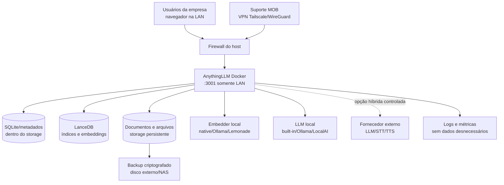

# MOB Box | Arquitetura técnica local com AnythingLLM e Docker

**Versão:** 14 de novembro de 2026  
**Objetivo:** definir uma primeira arquitetura implantável e gerenciável para a MOB Box, usando AnythingLLM self-hosted em Docker, com processamento local por padrão e opção híbrida controlada.

## 1. Decisão arquitetural

A primeira versão da MOB Box deve ser uma **appliance gerenciada**, não uma coleção de serviços expostos diretamente na rede do cliente.

A recomendação é:

- Ubuntu Server LTS ou Debian estável no host;
- Docker Engine e Docker Compose;
- um container principal do AnythingLLM Docker;
- armazenamento persistente em disco local dedicado;
- LanceDB como banco vetorial inicial, se o host suportar AVX2;
- modelo local embutido ou um servidor local de inferência separado;
- acesso somente pela rede interna, sem abrir a porta do AnythingLLM diretamente na internet;
- Tailscale ou WireGuard no host para suporte remoto controlado;
- firewall, contas individuais, backup criptografado e restauração testada.

A documentação oficial informa que a imagem Docker do AnythingLLM usa a porta 3001, precisa de um volume persistente em `/app/server/storage` e roda por padrão com UID/GID 1000. Sem o volume, os dados podem ser perdidos quando o container for recriado. [1] [2]

## 2. Diagrama lógico



O desenho separa quatro funções que normalmente são confundidas:

1. **Interface e autenticação:** AnythingLLM Docker, usuários, workspaces e permissões.
2. **Conhecimento:** documentos, processamento, embeddings e banco vetorial.
3. **Inferência:** modelo que gera a resposta, local ou externo.
4. **Operação:** armazenamento, backup, atualização, firewall, VPN e suporte.

“Rodar localmente” deve ser especificado por função. Uma Box pode manter documentos e embeddings localmente e ainda enviar o contexto de uma pergunta a uma API externa. Nesse caso ela é híbrida, não 100% local.

## 3. Hardware recomendado por fase

### MOB Box Compact — primeira implantação

Para uma primeira validação com poucos usuários, use:

- CPU Intel ou AMD com AVX2;
- 16 GB de RAM;
- SSD NVMe de 512 GB ou 1 TB;
- rede Gigabit;
- nobreak, quando possível;
- sem GPU dedicada no início;
- modelo externo autorizado ou modelo local pequeno por CPU.

O AnythingLLM documenta 2 GB de RAM, CPU de dois núcleos com AVX2 e 5 GB de armazenamento como configuração mínima para a aplicação, mas isso não representa uma recomendação para executar modelos locais grandes ou atender vários usuários simultâneos. Modelos locais exigem memória e, idealmente, GPU adicionais. [3]

Para a MOB Box real, 16 GB deve ser considerado ponto de partida para a aplicação e documentos, não promessa de desempenho para qualquer modelo. Meça latência, tamanho de contexto, ingestão e usuários simultâneos com o workflow do cliente.

### MOB Box Pro — inferência local mais forte

Use:

- 32 GB de RAM;
- SSD NVMe de 1 TB ou mais;
- GPU NVIDIA com VRAM suficiente para o modelo escolhido, ou GPU compatível com Vulkan;
- nobreak e ventilação adequados;
- disco separado ou política de backup externa.

O AnythingLLM documenta suporte ao motor local embutido com NVIDIA/CUDA e AMD/Intel/Vulkan em determinados ambientes. Em Linux, GPU NVIDIA exige NVIDIA Container Toolkit; para AMD/Intel, a documentação usa `/dev/dri` e grupo `render`. [4]

Não venda “Pro” pelo nome do hardware. Venda com base em um teste de aceite: modelo, contexto, latência, usuários, volume de documentos e qualidade do workflow.

### MOB Box Ultra

Deixe a Ultra para uma fase posterior. Ela só faz sentido quando houver necessidade comprovada de transcrição local pesada, vários usuários simultâneos, múltiplos modelos ou baixa dependência externa. GPU, calor, energia, manutenção e substituição aumentam o custo total.

## 4. Organização do disco

Use um disco de dados separado do sistema operacional quando possível. Uma estrutura inicial:

```text
/srv/mob-box/
├── anythingllm/
│   ├── storage/          # volume persistente do AnythingLLM
│   ├── .env              # segredos; permissões restritas
│   └── backups/          # cópias temporárias locais, não única cópia
├── models/               # se o modelo local for separado
├── exports/              # exportações controladas do cliente
├── staging/              # arquivos recebidos antes da aprovação
└── scripts/
    ├── backup.sh
    ├── healthcheck.sh
    └── restore-test.sh
```

Não use `chmod -R 777` como correção de permissões. A documentação oficial recomenda que o storage pertença ao UID/GID usado pelo container, normalmente 1000:1000. [2]

A pasta `staging` não deve entrar automaticamente na base de conhecimento. Os arquivos devem passar por aprovação, verificação de formato, identificação de versão e, quando aplicável, classificação de dados.

## 5. Estratégia de modelos

### Fase inicial: AnythingLLM + modelo local pequeno ou híbrido

Há duas configurações razoáveis.

**Configuração A — container com motor local embutido.** Ative o motor embutido do AnythingLLM com `ENABLE_BUILT_IN_LLM=true`. A documentação informa que o motor é opcional, que os modelos são armazenados no storage e que GPU é recomendada para melhor velocidade. [4]

Vantagem: menos serviços para manter. Desvantagem: menor separação operacional entre interface e inferência, além de maior consumo de disco e memória no container principal.

**Configuração B — AnythingLLM separado do servidor de inferência.** Execute AnythingLLM e Ollama ou outro servidor compatível em containers separados. O AnythingLLM conversa com o serviço pelo nome interno da rede Docker, por exemplo `http://ollama:11434`, e não por `127.0.0.1`.

Vantagem: troca de modelo e diagnóstico mais simples. Desvantagem: mais serviços, volumes, atualizações e controles.

Para a MOB, recomendo começar com a Configuração A em Compact quando o modelo local for pequeno. Na Pro, use Configuração B se houver necessidade de trocar modelos, manter inferência separada ou fazer testes de carga.

### Embeddings

Comece com embedder local, para não enviar documentos a um provedor externo. O repositório oficial lista embedder nativo, Ollama, LocalAI e provedores externos, além de LanceDB como banco vetorial padrão. [5]

O embedder deve ser decidido junto com o idioma, o tipo de documento e o tamanho da base. Não misture embeddings produzidos por modelos diferentes sem reindexar a base.

### Banco vetorial

Use LanceDB no primeiro piloto se o processador oferecer AVX2 e o volume for pequeno ou médio. A documentação aponta AVX2 como requisito importante para o caminho padrão com LanceDB. Se o host não oferecer AVX2, escolha outro banco vetorial suportado, como PGVector, Qdrant ou Chroma, e aceite a complexidade de operar outro serviço. [3]

Para a primeira Box, não adicione PostgreSQL, Qdrant ou Redis sem necessidade. Cada serviço adicional aumenta backup, patching, monitoramento e risco de falha.

## 6. Compose de referência para a Compact

Este é um ponto de partida, não um arquivo de produção pronto. Troque segredos, fixe uma versão testada da imagem e valide os nomes das variáveis na documentação da versão escolhida.

```yaml
services:
  anythingllm:
    image: mintplexlabs/anythingllm:<VERSAO_TESTADA>
    container_name: mob-anythingllm
    restart: unless-stopped
    init: true
    ports:
      # Substitua pelo IP LAN fixo da Box; não publique em 0.0.0.0 sem firewall.
      - "192.168.50.10:3001:3001"
    cap_add:
      - SYS_ADMIN
    environment:
      STORAGE_DIR: /app/server/storage
      JWT_SECRET: ${JWT_SECRET}
      PASSWORDMINCHAR: "12"
      VECTOR_DB: lancedb
      # Defina um único caminho de inferência na instalação.
      # Opção local embutida:
      # ENABLE_BUILT_IN_LLM: "true"
      # Opção com servidor externo na mesma rede Docker:
      # LLM_PROVIDER: ollama
      # OLLAMA_BASE_PATH: http://ollama:11434
      # OLLAMA_MODEL_PREF: <MODELO_VALIDADO>
      # EMBEDDING_ENGINE: ollama
      # EMBEDDING_BASE_PATH: http://ollama:11434
      # EMBEDDING_MODEL_PREF: <EMBEDDER_VALIDADO>
      # WHISPER_PROVIDER: local
      # TTS_PROVIDER: native
    volumes:
      - /srv/mob-box/anythingllm/storage:/app/server/storage
      - /srv/mob-box/anythingllm/.env:/app/server/.env:ro
    networks:
      - mob_internal

networks:
  mob_internal:
    driver: bridge
```

A documentação oficial mostra `STORAGE_DIR`, `JWT_SECRET`, `VECTOR_DB`, o volume persistente e o uso da porta 3001 no Compose. Ela também alerta que o container roda como usuário não privilegiado e que permissões incorretas no volume impedem a abertura do banco. [2] [4]

O uso de `cap_add: SYS_ADMIN` aparece na configuração oficial de Docker, mas deve ser avaliado pela MOB em relação ao princípio do menor privilégio. Não adicione serviços, capabilities ou portas sem entender por que são necessários.

## 7. Compose opcional com Ollama separado

Use esta opção somente quando a Box tiver memória, GPU e necessidade real de separar o serviço de inferência.

```yaml
services:
  anythingllm:
    image: mintplexlabs/anythingllm:<VERSAO_TESTADA>
    container_name: mob-anythingllm
    restart: unless-stopped
    ports:
      - "192.168.50.10:3001:3001"
    cap_add:
      - SYS_ADMIN
    environment:
      STORAGE_DIR: /app/server/storage
      JWT_SECRET: ${JWT_SECRET}
      VECTOR_DB: lancedb
      LLM_PROVIDER: ollama
      OLLAMA_BASE_PATH: http://ollama:11434
      OLLAMA_MODEL_PREF: <MODELO_VALIDADO>
      EMBEDDING_ENGINE: ollama
      EMBEDDING_BASE_PATH: http://ollama:11434
      EMBEDDING_MODEL_PREF: <EMBEDDER_VALIDADO>
    volumes:
      - /srv/mob-box/anythingllm/storage:/app/server/storage
    depends_on:
      - ollama
    networks:
      - mob_internal

  ollama:
    image: ollama/ollama:<VERSAO_FIXADA>
    container_name: mob-ollama
    restart: unless-stopped
    volumes:
      - /srv/mob-box/models/ollama:/root/.ollama
    # Para NVIDIA, configure o runtime conforme o host e a documentação do Ollama.
    networks:
      - mob_internal

networks:
  mob_internal:
    driver: bridge
```

Não exponha a porta do Ollama para a rede do cliente. Somente AnythingLLM deve ser acessível pelos usuários. O serviço de inferência deve ficar na rede interna do Docker.

## 8. Rede e acesso

### Acesso local

Use um IP fixo ou reserva DHCP para a Box. Publique somente a porta do AnythingLLM na rede interna, idealmente limitada ao segmento ou VLAN dos usuários autorizados.

Use firewall para:

- permitir acesso à porta 3001 somente da rede autorizada;
- bloquear acesso externo direto;
- bloquear portas administrativas desnecessárias;
- permitir atualização e suporte somente pelo canal definido;
- registrar tentativas de acesso relevantes.

Um domínio local como `ia.empresa.local` ou um registro DNS interno pode ser usado, mas `mob.local` depende de resolução mDNS e pode falhar em redes Windows heterogêneas. Para a primeira instalação, IP reservado ou DNS interno controlado costuma ser mais previsível.

### Acesso remoto da MOB

Não abra a porta 3001 no roteador do cliente. Use uma VPN de administração, como Tailscale ou WireGuard, instalada e documentada no host. O acesso deve ter:

- conta individual;
- MFA quando disponível;
- menor privilégio;
- registro de conexão;
- janela de suporte;
- processo de revogação no encerramento;
- separação entre acesso de administração e acesso do usuário final.

A MOB deve informar no contrato que o suporte remoto existe, quais dados podem ser acessados, em que situações, por quanto tempo ficam os logs e como a conexão é revogada.

## 9. Autenticação, workspaces e permissões

O AnythingLLM Docker oferece recursos multiusuário e permissionamento. Use um workspace por departamento ou finalidade somente quando isso melhorar a segregação. Não crie um workspace único com todos os documentos de RH, financeiro, contratos e comercial.

Estrutura inicial recomendada:

- `Comercial — base aprovada`;
- `Operações — procedimentos`;
- `Financeiro — acesso restrito`;
- `RH — acesso restrito`;
- `MOB — administração técnica`.

Crie contas individuais. Não compartilhe a senha de administrador. Desabilite ou altere credenciais padrão, ative política de senha forte e, se a edição/arquitetura permitir, habilite SSO ou MFA.

Não coloque documentos sensíveis em um workspace amplo apenas porque “a IA precisa conhecer tudo”. O assistente deve receber somente a base necessária para a finalidade.

## 10. Documentos e ingestão

A experiência “jogue o arquivo na pasta” deve ser implementada como fluxo de aprovação, não como indexação cega.

Pipeline recomendado:

1. arquivo chega em `staging`;
2. sistema verifica extensão, tamanho, duplicidade e malware;
3. responsável confirma cliente, setor, finalidade e versão;
4. arquivo é convertido ou extraído;
5. documento é indexado no workspace correto;
6. operador testa uma pergunta conhecida;
7. documento é marcado como ativo;
8. documento antigo é arquivado ou removido conforme política;
9. exclusão também remove índice, embeddings e cópias conforme o ciclo de retenção.

O AnythingLLM oferece ingestão, workspaces e citações, mas a MOB deve criar o procedimento operacional e o controle de versionamento. RAG não garante que um documento errado, antigo ou conflitante deixe de influenciar a resposta.

Na primeira versão, prefira upload pela interface com aprovação a um watcher automático de Samba. Depois que o pipeline estiver testado, adicione uma pasta de entrada com script que chama a API do AnythingLLM, registra o resultado e envia falhas para uma fila de revisão.

## 11. Backup e restauração

O volume `/app/server/storage` é crítico. Faça backup de:

- banco e metadados;
- documentos originais;
- índices vetoriais;
- configurações;
- exportações necessárias;
- arquivos de ambiente e segredos, com proteção adequada;
- modelos locais, quando o tempo de download for relevante.

Use a regra operacional 3-2-1 quando o orçamento permitir: três cópias, em dois meios, uma fora do equipamento. Backup local no mesmo SSD não protege contra falha, ransomware ou furto.

O backup deve ser criptografado, ter retenção definida e ser testado em restauração. Não basta verificar se o arquivo `.tar` existe. O teste deve subir uma instância isolada, restaurar o storage e responder a um caso conhecido.

Não copie chaves de API em texto aberto para a pasta de backup sem criptografia. Na saída do cliente, revogue tokens, remova acesso VPN e execute o procedimento de exportação e eliminação contratado.

## 12. Atualizações e versões

Não use `latest` automaticamente em produção. Mantenha:

- versão da imagem testada;
- hash ou tag definida;
- registro de data de atualização;
- backup antes do update;
- janela de manutenção;
- teste de saúde;
- teste de login, upload, busca, resposta com fonte e permissões;
- rollback documentado.

A documentação pública consultada indica o AnythingLLM v1.19.0 como versão destacada na página no momento da consulta, mas a MOB deve confirmar a versão disponível antes de cada implantação. [1]

Atualize primeiro uma Box de laboratório. Só depois replique para clientes. Não atualize todas as Boxes simultaneamente.

## 13. Monitoramento mínimo

Crie um healthcheck diário para:

- container ativo;
- espaço livre em disco;
- saúde do SSD;
- memória e temperatura;
- carga de CPU/GPU;
- resposta da porta 3001;
- capacidade de login de teste;
- último backup concluído;
- idade do último teste de restauração;
- conectividade com modelo local ou provedor externo;
- número de erros de ingestão;
- falhas de permissão ou tentativas anômalas.

Não armazene o conteúdo integral das conversas em logs de infraestrutura por padrão. Logue metadados necessários para operação e auditoria, com retenção definida.

## 14. Modelo local versus híbrido

### Local

No local, AnythingLLM, documentos, embeddings, modelo, transcrição e logs ficam no ambiente do cliente. É a única configuração que permite uma promessa próxima de “não sair da Box”, desde que também se controle suporte, backup, atualização, telemetria e fornecedores.

Trade-offs: maior custo de hardware, manutenção, atualização de modelos, qualidade variável, latência e necessidade de backup local.

### Híbrido

No híbrido, documentos e base podem ficar localmente, mas prompts ou trechos recuperados são enviados a um provedor externo. O contrato e a ficha técnica precisam identificar:

- quais dados saem;
- qual modelo recebe;
- em que país ocorre o processamento;
- retenção;
- treinamento do provedor;
- suboperadores;
- custo por uso;
- procedimento de fallback;
- como desabilitar o caminho externo.

Não descreva a Compact como “privada” sem qualificador. Prefira: **“dados e base documental mantidos localmente; determinados fluxos podem usar provedor externo conforme configuração aprovada”**.

## 15. O que eu colocaria na imagem mestre da MOB

A imagem mestre deve conter:

- sistema operacional endurecido;
- Docker Engine e Compose;
- AnythingLLM em versão fixada;
- política de firewall;
- script de healthcheck;
- script de backup;
- template de `.env` sem segredos;
- documentação de instalação;
- usuário administrativo inicial que será trocado na entrega;
- checklist de aceite;
- procedimento de atualização e rollback;
- inventário de componentes e licenças;
- agente de monitoramento mínimo;
- pacote de configuração da MOB versionado separadamente.

Não coloque documentos de um cliente dentro da imagem mestre. A imagem deve ser clonável, mas os dados, segredos, usuários, chaves, embeddings e configurações de cada cliente devem ser criados no provisionamento.

## 16. Checklist de aceite da primeira MOB Box

Antes de entregar, teste:

- acesso de usuário comum;
- acesso de administrador;
- isolamento entre workspaces;
- upload de PDF, DOCX e planilha suportados;
- documento escaneado ou inválido encaminhado para revisão;
- resposta com fonte;
- resposta “não encontrado” quando a base não contém a informação;
- exclusão e reindexação;
- backup e restauração;
- reinício após queda de energia;
- reinício dos containers;
- acesso remoto da MOB e revogação;
- atualização de versão em laboratório;
- comportamento sem internet, se a oferta for local;
- custo e latência por tarefa;
- desempenho com o número contratado de usuários;
- remoção de chaves e dados de teste.

## 17. Roteiro de implantação

### Laboratório da MOB

Monte uma máquina de referência, documente versões, selecione dois modelos e crie uma base de documentos sintéticos. Teste três workflows e meça tempo, custo, qualidade e falhas.

### Piloto do cliente

Comece com uma única equipe, um único workspace e documentos aprovados. Use dados reais somente depois de contrato, DPA, usuários e regras de acesso estarem definidos.

### Produção

Aplique backup, firewall, VPN, contas individuais, treinamento e aceite. Registre o inventário e entregue uma ficha de transparência que indique arquitetura, dados, fornecedores e limitações.

### Operação mensal

Faça uma revisão mensal de uso, erros, consumo, documentos, permissões, backup e atualizações. O MOB CORE deve armazenar o estado da configuração, mas não deve centralizar dados de todos os clientes sem segregação forte.

## 18. Recomendação final

Para a primeira MOB Box, use **AnythingLLM Docker + LanceDB + embedder local + um modelo local pequeno ou híbrido claramente identificado**, em uma máquina Linux com SSD, 16 GB de RAM e CPU AVX2. Não comece com uma arquitetura distribuída, Kubernetes, PostgreSQL, Qdrant, múltiplos agentes e cinco integrações. Cada componente adicional aumenta a superfície de falha.

O valor da MOB não estará em simplesmente instalar o container. Estará em entregar uma instância com dados segregados, fontes visíveis, revisão humana, backup restaurável, atualizações reversíveis, suporte remoto controlado e um processo que o cliente consiga usar sem virar administrador de infraestrutura.

## Referências

[1]: https://docs.anythingllm.com/installation-docker/quickstart "AnythingLLM — Docker Quickstart"
[2]: https://docs.anythingllm.com/installation-docker/local-docker "AnythingLLM — Local Docker"
[3]: https://docs.anythingllm.com/installation-docker/system-requirements "AnythingLLM — System Requirements"
[4]: https://github.com/Mintplex-Labs/anything-llm/blob/master/docker/HOW_TO_USE_DOCKER.md "AnythingLLM — How to use Docker"
[5]: https://github.com/Mintplex-Labs/anything-llm "Mintplex Labs — AnythingLLM repository and supported providers"
